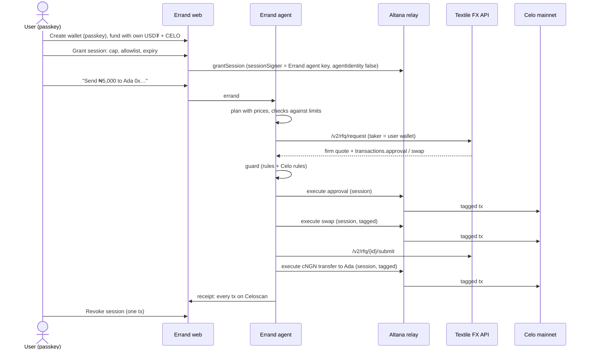
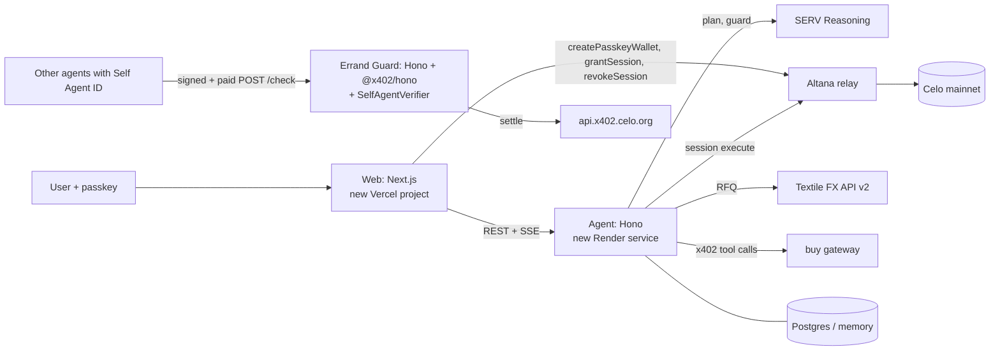

# PRD: Errand on Celo

**Errand runs your errands in Naira from your own wallet. You set the cap, it can only call what you allow, and only agents with a real human behind them get served by its guard.**

| | |
|---|---|
| Event | Agents Open for Business (Celo · Loops House). Rules: [docs/celo/RULES.md](docs/celo/RULES.md) |
| Deadline | **Mon 7 Dec 2026, 09:00 GMT (10:00 Lagos)**. Internal deadline: Sun 6 Dec, 18:00 Lagos |
| Builder | Benjamin Ugochukwu (solo) |
| Repo / branch | github.com/softalpha0/Errand · `celo` (start point: tag `pre-celo-hackathon`) |
| Attribution tag | `celo_511bb691f2f0` |
| Status | Draft 1, 23 Nov 2026. Sections marked **SPIKE** depend on a test in [docs/celo/BUILD-PLAN.md](docs/celo/BUILD-PLAN.md) |

---

> **Update 24 Nov 2026:** Errand is no longer Nigeria-only. It pays out in any hackathon corridor with live Textile liquidity (cNGN, IDRX, wARS, wBRL today; wMXN/wCOP when makers return), with limits in dollars ($1.10–$35 per errand while testing). Nigeria stays the launch market for the first named users. Details: AGENTS.md → Decisions.

## 1. Problem

People in Nigeria pay people and small businesses in Naira every day: a market supplier, a tailor, rent, a family member's data. A person who holds dollars in stablecoins has two bad options for letting an agent do this:

1. Give the agent a wallet key, and trust it with everything in it.
2. Do every conversion and transfer by hand.

Spending limits help, but a limit alone doesn't stop an agent from calling the wrong contract, paying the wrong person, or paying twice inside the limit. Errand's attack benchmark (from the SERV build, `evidence/benchmark.md`) showed caps alone let 18 of 20 attacks through.

## 2. Users

| Who | Job | Status |
|---|---|---|
| **Primary: a named person in Nigeria who holds USD₮ and pays people in Naira** | "Pay my supplier ₦X in cNGN every Friday" / "send ₦X to my sister" without handing over a key | **To find.** Benjamin must name at least one real user outside the team who funds their own wallet (FAQ: an independent user is a wallet you didn't fund). No invented names in any doc, README or video |
| Recipient | Receives cNGN | Must be outside the team (Corridors requirement 2) and able to use cNGN (cngn.co) |
| Other agents | Pay Errand Guard to check a payment before they make it | Another team's agent with its own ERC-8004 identity counts as an independent user when it pays Errand |

## 3. What Errand does on Celo

1. **The user owns the wallet.** They create a non-custodial **Altana** wallet (passkey) in Errand's web app and fund it with their own USD₮.
2. **The user grants Errand a session** with an onchain spend cap (USD₮, and cNGN), an allowlist of exactly the contracts Errand may call, and an expiry. They can revoke it in one transaction from the same screen.
3. **The user gives an errand** in plain words, e.g. "Send ₦5,000 to Ada (0x…) and email me the receipt." Errand plans it with a price on every step, as it does today.
4. **Every payment goes through Errand's guard** (rules R1–R13 + new Celo rules), then executes from the user's wallet under the session:
   - **FX step:** request a Textile FX firm quote USD₮→cNGN, approve, swap (tagged), submit.
   - **Pay step:** transfer cNGN to the named recipient (tagged).
   - **Tool step:** pay for what the job needs on **buy** (e.g. LLM inference) over x402.
5. **The user gets a receipt** with every payment, the quoted rate, the reason it was approved, and a Celoscan link for each transaction.
6. **Errand Guard** (an x402 service on Celo) lets any agent pay a small fee to have a payment checked first. Agents with a **Self Agent ID** (a verified human behind them) get served at a higher limit. Agents without one are limited or rejected, and the demo shows the rejection.

## 4. Tracks targeted

A project can win in up to two tracks. Enter all three below; the best two placements count.

| Track | How Errand qualifies | Weight in our time |
|---|---|---|
| **Altana Agent Wallets** | Errand acts from each user's own Altana wallet under a session key the user grants (cap + allowlist + expiry, revocable in one tx) | High |
| **Stablecoin Corridors** | Tagged Textile FX conversion USD₮→cNGN inside the errand flow; cNGN reaches a recipient outside the team; ERC-8004 registered; no arbitrage | High |
| **Self Agent ID** | Errand Guard uses Self Agent ID to decide which agents get served, at what limit, with payments through x402 | Medium |
| Agent Vault | **Stretch only**, after must-haves work (see §9) | Low |

## 5. Agent wallet model (decision D1)

The hackathon ties the score to **one agent wallet** for the whole event, and ERC-8004 is registered from it.

| Role | Key | Used for |
|---|---|---|
| **Errand agent key** (one EOA) | Created by **Self Agent ID registration in `wallet-free` mode** (Self generates the key; export it within 30 min; the agent key owns the Self NFT) | 1. Session signer on every user's Altana wallet (`sessionSigner`). 2. Registers Errand on the canonical ERC-8004 registry. 3. PayTo address for Errand Guard. 4. The agent wallet entered on Loops |
| **User wallets** | Each user's Altana passkey wallet | Hold the user's USD₮. Created with `agentIdentity: false` so they are not registered as agents |

Why this order: Self's EVM modes generate the agent key, so the Self step must come first. Using that same key everywhere means one identity, one wallet, one score.

**Pending confirmation (Telegram):** do tagged txs sent from users' Altana wallets, signed by Errand's agent key as session signer, count toward the entry? If the answer is no, adjust before mainnet volume (see BUILD-PLAN, Q1).

## 6. User journeys

### J1. First errand (the demo journey)

### J2. Revoke
User clicks **Revoke** → `revokeSession` → the next Errand attempt fails at validation, and the UI shows it.

### J3. Errand Guard for other agents (Self track)
1. An agent sends `POST /check` signed with its Self Agent ID headers.
2. The guard reads `x-self-agent-*` headers and verifies with `SelfAgentVerifier`.
3. Verified agents get a 402 at the standard price with a higher daily limit. Unverified agents get a lower limit, or a clear rejection.
4. The agent pays over x402 (Celo facilitator, USD₮ or cNGN). The guard returns `approve | ask | block` with a reason.

## 7. Scope (MoSCoW)

### Must
1. `packages/celo`: chain config, token table with startup `decimals()` assertions, attribution (done), viem clients with `withAttribution`.
2. Errand agent key via Self Agent ID (`wallet-free`, mainnet). ERC-8004 registration on `0x8004A169…a432` from that key, tagged. Agent card JSON hosted.
3. Altana user wallet: create (passkey), fund instructions, grant session (cap + allowlist + expiry + fee token), show session status, revoke.
4. Textile FX client: preview, request, approve → wait → swap (tagged) → submit → poll; `no_quote` handling; 75 s timeout.
5. Errand step types for Celo: `fx.convert`, `pay.local` (cNGN transfer), `tool.buy` (one buy capability). Catalog entries + guard rules for each.
6. Guard rules for Celo (R14–R17, §8). Existing R1–R13 still apply where relevant.
7. Receipts with Celoscan links, quoted rate, and `verifyTx` result per tx.
8. Errand Guard on Celo x402 with Self Agent ID gating; PayTo = agent key; rejection shown in demo.
9. Demo mode still works with no wallet (simulated and labelled).
10. New deployments: separate Vercel project and Render service for the Celo build. **Do not touch** `errand-pearl.vercel.app` or the existing Render services.
11. Evidence: tagged tx hashes, `verifyTx` outputs, Textile RFQ ids, recipient confirmation, ERC-8004 agentId, Self agentId.
12. README rewritten for Celo in the cadence structure (Benjamin's standard).

### Should
1. Standing errand ("pay my supplier every Friday") on the Altana session.
2. Paying Errand Guard in cNGN (Permit2 route, no `eip2612GasSponsoring`).
3. Telegram bot path for the Celo build.

### Could
1. Agent Vault checkout on a Nigerian website (stretch, §9).
2. wFIAT corridors (wBRL/wARS) for a LATAM recipient.

### Won't (this event)
1. Custody of user funds or funding users' wallets (it would also disqualify them as independent users).
2. Arbitrage, self-trading, acting as a Textile maker.
3. Kite/Base payments on the Celo build (kept on `main` for the SERV entry).
4. Any claim in README/video that hasn't run on mainnet.

## 8. New guard rules (packages/core)

| Rule | Blocks | Notes |
|---|---|---|
| R14 corridor | An FX step whose token pair isn't USD₮↔(cNGN, IDRX, wARS, wBRL, wMXN, wCOP) on chain 42220 | Hackathon corridors only |
| R15 quote | A swap whose firm quote is expired (`now >= expiresAt`), whose `taker` isn't the user's wallet, whose `to` isn't the Textile LimitOrderReactor, or whose `takerPays` exceeds the step's planned max | All values come from the quote response |
| R16 contract allowlist | Any call whose `to` isn't in the session allowlist the user approved | Mirrors the onchain allowlist, so Errand refuses before the chain does |
| R17 untagged | Any Celo tx whose calldata doesn't end with Errand's tag (`hasErrandTag`) | Never send untagged |
| R5/R6/R12 (existing) | Also apply to **x402 payments from the session** | Altana: session caps do **not** bound x402 payments |

## 9. Agent Vault (stretch)

Only after all Musts run on mainnet. Idea: a small real checkout on a Nigerian website with Benjamin's own card through Agent Vault, plus the x402 payment Errand already makes on buy. Blocked on: Agent Vault supporting the card/country (UNVERIFIED). A free test: sign up (hackathon gives 3 months of Plus) and try one manual fill.

## 10. Architecture

Package layout additions (keep the cadence monorepo shape):

| Path | What |
|---|---|
| `packages/celo` | Chain/tokens, attribution, Textile client, Altana helpers, ERC-8004 + Self scripts. Pure where possible, Vitest |
| `apps/agent` | New `celo` payment rail behind `PAYMENT_RAIL=celo`; Kite rail code stays but is off on this build |
| `apps/web` | Wallet + session screens, Celo receipts |
| `apps/guard-celo` | Errand Guard on Celo x402 with Self Agent ID |
| `evidence/celo/` | Tx hashes, `verifyTx` JSON, RFQ ids, screenshots |

## 11. Guarantees (what the README will promise, only once tested)

| Guarantee | Enforced by |
|---|---|
| Errand can't spend more than the cap | Altana onchain spend cap + R5/R6 |
| Errand can only call approved contracts | Altana onchain call allowlist + R16 |
| The user can stop Errand in one tx | `revokeSession` |
| Every Errand tx is attributable | `withAttribution` / `tagCalldata` + R17 + `verifyTx` in receipts |
| A seller's text can't make Errand buy something | R1 (existing) |
| FX never executes on a stale or foreign quote | R15 |

## 12. Done statement

A named user outside the team, with a wallet they funded themselves, runs one real errand on the live Celo site: Errand converts USD₮→cNGN on Textile FX and pays cNGN to a recipient outside the team, from the user's Altana wallet under a session the user granted. Every tx shows `celo_511bb691f2f0` in `verifyTx`. The user revokes the session in one tx and the next attempt is refused. Another agent with a Self Agent ID pays Errand Guard over x402 and gets served; one without is limited, on video.

## 13. Success metrics

| Metric | Target (honest minimum) |
|---|---|
| Independent user wallets that ran a real errand | ≥ 3 |
| Tagged mainnet txs credited to the tag | ≥ 30 |
| Textile FX conversions in product flow | ≥ 5 |
| Distinct cNGN recipients outside the team | ≥ 3 |
| Paid Errand Guard calls from other agents | ≥ 1 from another team's ERC-8004 agent |
| Paid buy calls from Errand | ≥ 5 |

## 14. Risks and open questions

| # | Risk / question | Plan |
|---|---|---|
| Q1 | Do user-wallet txs signed by the agent key count for the entry? | Asked in Telegram. Wait for the answer before mainnet volume |
| A1/A2 | Altana txs may not carry a readable tag (no `dataSuffix` in SDK; relay shape unknown) | Spike S1 on day 1. If it fails: ask Altana for a suffix option; fallback = run FX + payouts from the agent EOA and keep Altana for the session/cap story only (weaker) |
| A3 | Granting a session to a server-held key from the browser | Spike S2 |
| A4 | Altana KeyStore registration cost in CELO for every new user | Quote on mainnet; tell users the exact amount; consider USD₮ fee token for later txs |
| T1 | Textile `takerProof` from a smart wallet | Spike S3. Fallback: Textile API key (no `takerProof`) |
| T2 | USD₮→cNGN liquidity at $1–$20 | Live preview on day 1 |
| R1 | Recipient can't use cNGN | Confirm with each recipient before sending |
| R2 | Breaking the SERV submission | Separate branch, separate deployments, never touch `main` |

## 15. Non-functional

- Windows/PowerShell-friendly commands and scripts.
- Secrets only in `.env` (git-ignored) and host dashboards. `.self/` and any key files git-ignored.
- All public copy plain and specific (Benjamin's voice). No hype words.
