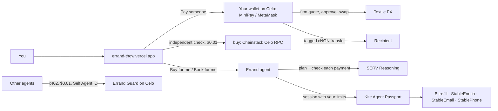

# Errand

**Runs your money errands. Never breaks your limits.** Errand is an agent that runs errands with your money, inside limits you set. It pays people in their local money from your own wallet, buys things such as airtime, data and eSIMs, and checks every payment before it is made. Every errand ends with a receipt anyone can check.

| | |
|---|---|
| **Live site** | https://errand-thgw.vercel.app |
| **First real Celo errand** | 2,000 cNGN paid from MiniPay to a person outside the team: [Celoscan](https://celoscan.io/tx/0xbc98dba3494297855374c797b939fc761964de23d119ab86f9e2541a1fd1e4e7) |
| **First real Kite errand** | ₦100 of MTN airtime bought through Kite Passport: [receipt](https://errand-thgw.vercel.app/r/e_My979K17) |
| **Agent identity** | ERC-8004 agent **#10107** · Self Agent ID **#214** · attribution tag `celo_511bb691f2f0` |
| **Hackathons** | SERV Hackathon 02 (Kite track, Nov 2026) · Agents Open for Business on Celo (Loops House, Nov–Dec 2026) |

## Contents

- [The problem](#the-problem)
- [What Errand does](#what-errand-does)
- [Errand's story](#errands-story)
- [Try it](#try-it)
- [Proof on mainnet](#proof-on-mainnet)
- [How it works](#how-it-works)
- [What's live and what isn't](#whats-live-and-what-isnt)
- [Run it yourself](#run-it-yourself)
- [Known limitations](#known-limitations)
- [What's next](#whats-next)
- [Credits and license](#credits-and-license)

## The problem

Many people now hold digital dollars, but the people they pay (a supplier, a landlord, family) need local money, airtime or a booking. Doing it by hand means converting, copying wallet addresses and checking every payment yourself, across several apps.

Agents could do this, but most need full control of your wallet. A spending limit helps, yet it doesn't stop waste inside the limit: paying twice, buying the wrong product at the right price, or following a seller's page that says "also buy the premium bundle". In Errand's attack benchmark, spending caps alone let **18 of 20** attacks through.

## What Errand does

You say what you want and set the limits. Errand plans the errand with a price on every step, checks each payment before it happens, pays, and gives you a receipt.

| Errand type | What it does | Where it runs | Status |
|---|---|---|---|
| **Pay someone** ([/errand](https://errand-thgw.vercel.app/errand)) | Sends an exact amount of local money to anyone: converts your USD₮ on Textile FX into cNGN (naira), IDRX (rupiah), wARS or wBRL and pays it from your own wallet, even inside MiniPay | Celo | **Live** |
| **Buy for me** ([/new](https://errand-thgw.vercel.app/new)) | Buys airtime and data (180+ countries), eSIMs, gift cards, Amazon orders, or researches before buying. SERV Reasoning checks each payment; sellers are paid through your own Kite Agent Passport | Kite Passport, USDC on Base | **Live** for airtime and data; the rest built and tested |
| **Book for me** | Finds a restaurant and phones it to book a table, through a paid AI phone call (US and Canada numbers) | Kite Passport (StablePhone) | Built and tested, not yet run on mainnet. Flights and hotels are next |

Errand is also **open for business to other agents**:

- **Errand Guard** (https://errand-guard-celo.onrender.com) is a paid x402 API on Celo. Any agent pays **$0.01 USD₮** to have a payment checked before it sends it. **Self Agent ID** decides who is served: agents with a verified human behind them get 100 checks a day, unknown agents 3. Refusals happen before payment, so nobody pays for a "no".
- Errand **pays for its own tools**: after every Celo errand it pays $0.01 on **buy** for a Chainstack Celo node to confirm the receipt independently.

## Errand's story

Errand existed before the Celo hackathon. It was built for SERV Hackathon 02 and then extended on Celo. Compare the tag [`pre-celo-hackathon`](https://github.com/softalpha0/Errand/tree/pre-celo-hackathon) with the `celo` branch to see exactly what was added for Celo.

| Date | What happened |
|---|---|
| 4 Nov 2026 | Errand starts, for SERV Hackathon 02: an agent that buys things through your Kite Agent Passport, with SERV Reasoning checking every payment |
| 5 Nov 2026 | First real errand: ₦100 of MTN airtime bought on mainnet through Kite Passport, 6 payments, $0.11 in total, confirmed by MTN |
| Nov 2026 | Attack benchmark: caps alone let 18 of 20 attacks through, Errand's rules 4, rules plus SERV 1 |
| 20 Nov 2026 | Agents Open for Business on Celo begins. Errand gets an on-chain identity (ERC-8004 #10107, Self Agent ID #214) |
| 24 Nov 2026 | Errand Guard live on Celo with Self Agent ID; first tagged Textile FX conversion |
| 25 Nov 2026 | First real Celo errand: a user outside the team sends exactly 2,000 cNGN to a friend from their own MiniPay wallet |

## Try it

**Pay someone (Celo).**
1. Open https://errand-thgw.vercel.app/errand inside **MiniPay** (Settings → About → tap the version 7 times → Developer Settings → Load Test Page, with testnet off), or in a browser with a Celo wallet such as MetaMask.
2. Pick a currency, enter the amount they should receive and their Celo wallet address. You need about $1.50 of USD₮ for a ₦2,000 errand.
3. Press **Send** and confirm three times: the USD₮ approval, the conversion, the payment. Inside MiniPay, network fees are paid in USD₮.
4. You get a receipt that re-checks every transaction on Celo. Share it with the **Share receipt** button.

The recipient receives the local stablecoin (for example cNGN, ₦1 each) in their wallet, not in a bank account.

**Buy for me (Kite).**
1. Open https://errand-thgw.vercel.app/new and pick an example, such as "Airtime for family".
2. To pay for real, connect your own Kite Passport on **Your Passport** ([/connect](https://errand-thgw.vercel.app/connect)); $1–2 of USDC is enough. Or switch the network to **Test** to run the same plan and checks with simulated payments.
3. Approve the Kite session with your passkey and watch each payment get checked and paid.

## Proof on mainnet

**Celo** (every Errand transaction carries `celo_511bb691f2f0`; full details in [evidence/celo](evidence/celo)):

| What | Transaction |
|---|---|
| First real errand: USD₮ approval | [0xed7c…1b5b](https://celoscan.io/tx/0xed7cea6c68f20c2cf33d9b3d54d24a23142ebddad4da14ed7d65962a27a21b5b) |
| First real errand: Textile FX conversion (RFQ `rfq_QoLfOy6xctjILf6f`) | [0x1a26…004e](https://celoscan.io/tx/0x1a260a0db329d452ed7c25d48c7e83bc6c217e8a37c2c5f50b0d6975df4a004e) |
| First real errand: 2,000 cNGN to a recipient outside the team | [0xbc98…e4e7](https://celoscan.io/tx/0xbc98dba3494297855374c797b939fc761964de23d119ab86f9e2541a1fd1e4e7) |
| Errand pays $0.01 on buy for an independent receipt check | [0xa0ac…1304](https://celoscan.io/tx/0xa0ac79b7c953592e46bdd84a11c9f2250171189a8bffbc42543727e796e91304) |
| Errand Guard paid check, Self-verified caller (agent 214) | [0x2108…1c03](https://celoscan.io/tx/0x210833696cf0e63cd10a4871a090dabee6d36b8c2532269cd1df3ebf46661c03) |
| Errand Guard paid check, unverified caller | [0x4781…a606](https://celoscan.io/tx/0x4781a9ca5856fba1c683793ff5868e848430c1221da74c719999e439742ea606) |
| ERC-8004 registration (agent #10107), tagged | [0x8b60…2b7c](https://celoscan.io/tx/0x8b6048637d36104e7c89d85efee0e1be8e9696fa7f00e485b79b9ee76f162b7c) |
| Builder's test conversion, 1 USD₮ → ₦1,445.12 cNGN (test wallet, not a user) | [0x9731…528b](https://celoscan.io/tx/0x9731a44d6f3b8c117059d313b33ace04ce3ca8b2e5420b476a5efdcb1b42528b) |

The first errand was run by an independent user with a wallet they funded themselves; the recipient confirmed the money arrived ([evidence/celo/first-errand.md](evidence/celo/first-errand.md)).

**Kite (Base):** 6 payments through Kite Passport, $0.11 in total, settled in USDC on Base; ₦100 of MTN airtime arrived and MTN confirmed it by SMS. Receipt: [/r/e_My979K17](https://errand-thgw.vercel.app/r/e_My979K17).

**Attack benchmark** (the same errand against 20 attacks and 9 real payments, [evidence/benchmark.md](evidence/benchmark.md), live at [/stats](https://errand-thgw.vercel.app/stats)):

| Setup | Attacks paid | Real payments still paid |
|---|---|---|
| Kite session caps only | 18 of 20 | 9 of 9 |
| Errand's fixed rules (R1–R13) | 4 of 20 | 9 of 9 |
| Rules + SERV guard graph | **1 of 20** | **9 of 9** |

## How it works



**Pay someone, step by step** (code in [apps/web/src/lib/errand.ts](apps/web/src/lib/errand.ts), rules in [packages/celo](packages/celo)):

1. **Check:** a supported currency, an amount worth $1.10–$35, a real recipient that isn't you, and a balance that covers the conversion plus network fees.
2. **Quote:** a firm Textile FX quote for the *exact* amount the recipient should get. Rule R15 refuses a quote more than 2% above the preview.
3. **Build and check every call:** R16 allows only the USD₮ approval to Textile's reactor, Textile's reactor, and `transfer()` on the chosen stablecoin. R17 refuses any call without Errand's tag.
4. **Approve → wait → recheck expiry → swap → Textile confirms the fill → pay the recipient.**
5. **Verify:** each transaction is read back from Celo for the tag, then Errand pays $0.01 on buy for a second node to confirm.

**Buy for me, step by step** (code in [apps/agent](apps/agent) and [packages/core](packages/core)):

1. SERV plans the errand with a price on every step; Errand asks Kite for **one session with exactly your limits**, approved with your passkey.
2. Every payment passes 13 fixed rules (only catalog sellers, only the listed price, only the people you named, never pay twice, stay under your caps), then a **SERV guard graph** decides whether it fits your task. SERV can only make a decision stricter.
3. You get the answer and a receipt with the quoted price, the reason and an on-chain link for every payment.

## What's live and what isn't

Only what has run on mainnet is marked **Live**.

| Feature | Status |
|---|---|
| Pay someone on Celo: Textile FX conversion + exact cNGN payout, tagged | **Live** (25 Nov 2026) |
| Works inside MiniPay: no connect button, network fees in USD₮ | **Live** |
| Receipts that re-check every transaction on Celo when opened | **Live** |
| Errand pays for its own tools on buy | **Live** |
| Errand Guard on Celo x402 with Self Agent ID tiers | **Live** |
| ERC-8004 + Self Agent ID identity | **Live** |
| Buy for me: airtime and data through Kite Passport | **Live** (5 Nov 2026) |
| Buy for me: eSIMs, gift cards, Amazon shopping, research | Built and tested, not yet run on mainnet |
| Book for me: table bookings by AI phone call (US and Canada) | Built and tested, not yet run on mainnet |
| Altana passkey wallet + session (daily cap, contract allowlist, expiry, one-tap revoke) | Built and live on the site; granting switched off until Altana confirms how grant/revoke transactions can carry the attribution tag |
| Repeat errands, Telegram bot, MCP server, Reppo second opinions | Built and tested |
| Flights and hotels; payouts straight to bank accounts | Not built |

Tests: 161 in total: 46 (Celo package), 20 (Errand Guard on Celo), 61 (core rules), 34 (agent). They run in GitHub Actions on every push to `main` and `celo`.

## Run it yourself

You need Node 22 and pnpm (through corepack). On Windows, run these in PowerShell, one at a time:

```powershell
git clone https://github.com/softalpha0/Errand.git
```

```powershell
cd Errand
```

```powershell
git checkout celo
```

```powershell
corepack enable
```

```powershell
pnpm install
```

```powershell
Copy-Item .env.example .env
```

```powershell
Copy-Item .env.example apps\web\.env.local
```

```powershell
pnpm dev
```

Open http://localhost:3000. Check everything with `pnpm test` and `pnpm typecheck`.

The main settings (all listed in [.env.example](.env.example)):

| Variable | What it's for |
|---|---|
| `TEXTILE_API_KEY` | Textile FX key, so firm quotes need no wallet signature (required for MiniPay) |
| `TOOLS_PAYER_KEY` | Errand's tools wallet, which pays $0.01 on buy for the independent receipt check |
| `X402_API_KEY`, `PAY_TO` | Errand Guard on Celo: the x402 facilitator key and the address that gets paid |
| `NEXT_PUBLIC_AGENT_URL` | Where the Buy-for-me agent runs |
| `ERRAND_MODE`, `SERV_API_KEY`, `KPASS_BIN`, … | The Buy-for-me agent: SERV Reasoning, Kite's `kpass` CLI and sellers. See [docs/deploy.md](docs/deploy.md) |

Useful scripts: `pnpm --filter @errand/celo textile-swap` (dry-run a Textile conversion), `pnpm --filter @errand/guard-celo pay-check` (pay Errand Guard once), `pnpm --filter @errand/celo tools-wallet`, `pnpm benchmark`.

### Project layout

```
apps/web/            The website: Pay someone, Buy for me, wallet, session, receipts, Results
apps/agent/          Buy-for-me agent: SERV client, Kite kpass wrapper, sellers, Reppo, Telegram, repeat errands
apps/guard-celo/     Errand Guard on Celo: x402 + Self Agent ID
apps/mcp/            MCP server
kite-service/        The earlier Errand Guard on Kite
packages/celo/       Celo: tokens, attribution tags, Textile FX client, rules R14–R17, currencies, sessions
packages/core/       Types, seller catalog, rules R1–R13, plan checks, attack benchmark
evidence/            Benchmark, Celo transactions, screenshots
docs/                Architecture, sellers, deploy, Celo rules and sponsor notes
```

## Known limitations

- Recipients of "Pay someone" get a local stablecoin in their wallet. Payout straight to a Nigerian bank account needs cNGN's merchant redemption API, which isn't set up yet.
- Altana sessions are built but switched off until Altana confirms how grant and revoke transactions can carry the attribution tag, so today you confirm each step in your own wallet.
- Errand Guard's daily limits are kept in memory and reset when the service restarts. It runs on Render's free plan, so the first call after a quiet spell can take about a minute.
- Gift card codes and eSIM QR codes go to the paying wallet's Bitrefill account. Errand confirms delivery but doesn't show the code.
- MiniPay support is for running Errand inside MiniPay, not a MiniPay listing.

## What's next

- Altana sessions: Errand works within a daily limit you set and can be switched off in one tap.
- Payouts straight to bank accounts, so recipients don't need a crypto wallet.
- Run eSIMs, gift cards, shopping and table bookings on mainnet; add flights and hotels.
- More independent users, and more local stablecoins as Textile adds liquidity.

## Team

**Benjamin Ugochukwu** ([GitHub @softalpha0](https://github.com/softalpha0), [X @tweetBysoft](https://x.com/tweetBysoft)): design, code and the live runs.

## Credits and license

Built on Celo with Textile FX, MiniPay, Self Agent ID, ERC-8004, x402 and buy (Celo Core Co.), and with SERV Reasoning by OpenServ, Kite Agent Passport and Reppo. Sellers: Bitrefill, StableEnrich, StableEmail, StablePhone.

Errand is released under the [MIT License](LICENSE).
