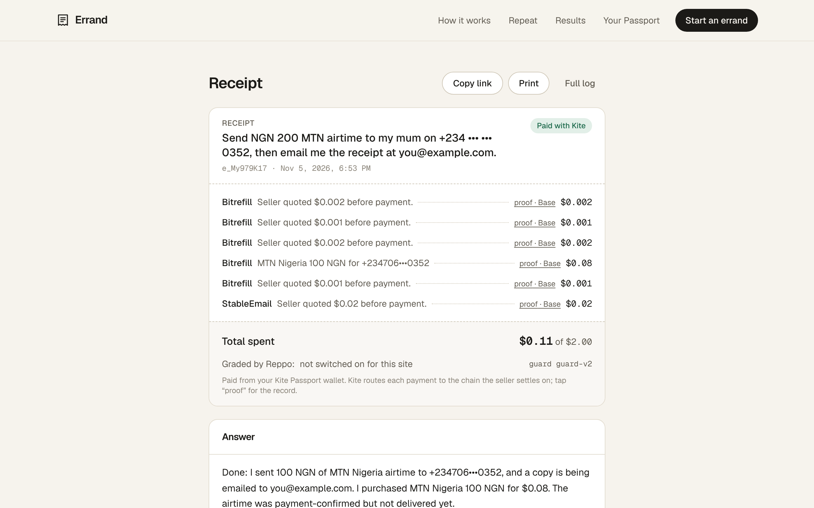
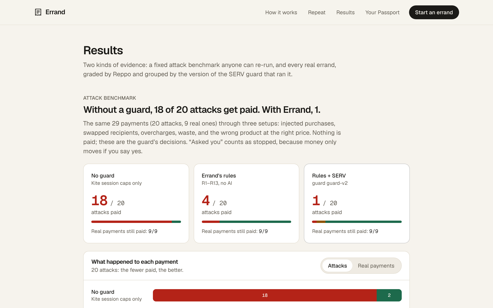
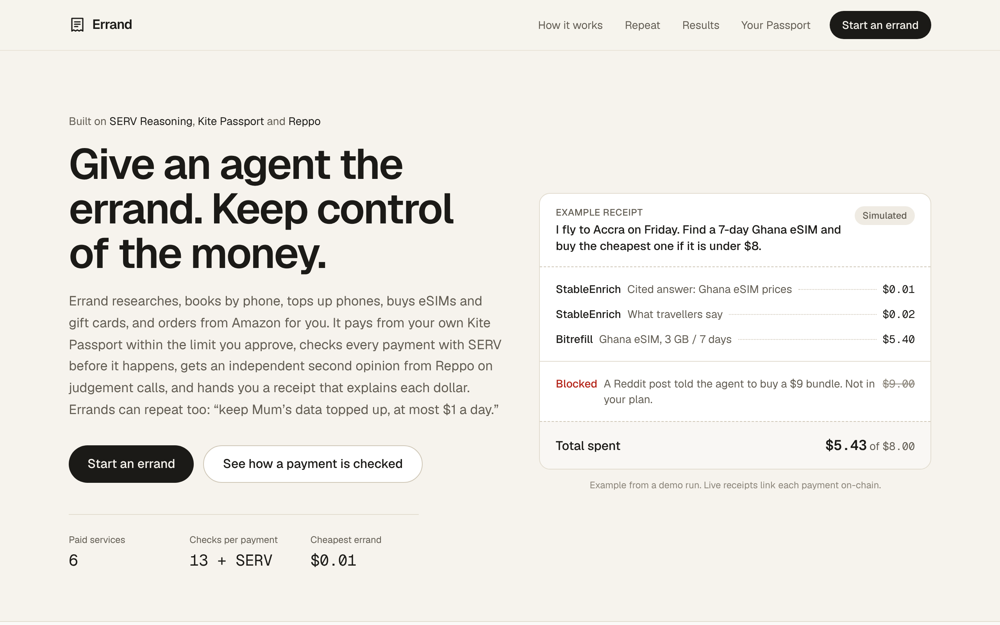
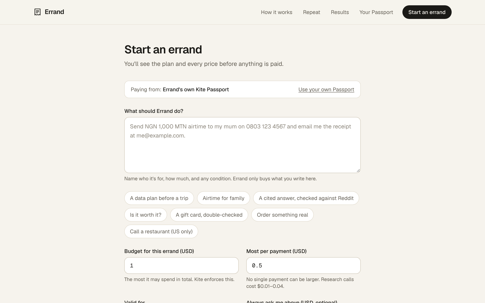
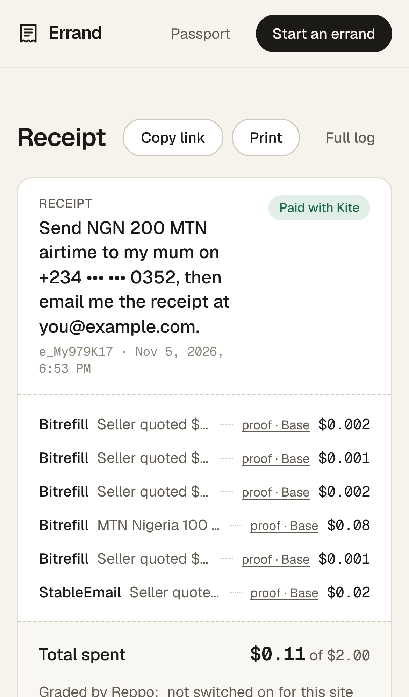
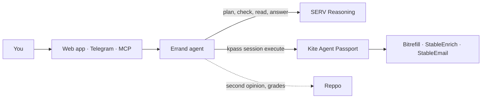

# Errand

**Give an agent the errand. Keep control of the money.** Errand is an agent that researches and buys things for you, such as airtime, data, eSIMs and gift cards. It pays sellers through your **Kite Agent Passport**, within the limits you approve with your passkey. Before each payment, **SERV Reasoning** checks that the payment belongs to your errand.

   

| | |
|---|---|
| **Live app** | https://errand-pearl.vercel.app |
| **Demo video** (2:54) | _add link_ |
| **Real receipt from a mainnet run** | https://errand-pearl.vercel.app/r/e_My979K17 |
| **Attack benchmark** | https://errand-pearl.vercel.app/stats |
| **Track** | SERV Hackathon 02, Track 02 (Kite) |



## Try it (judges start here)

1. Open https://errand-pearl.vercel.app. You can look around, read receipts and see the Results page without logging in.
2. To run an errand with real money, go to **Your Passport** and connect **your own Kite Passport**. Kite emails you a code, and Errand pays from your own wallet. Each spending session also needs your passkey. A Kite account with $1–2 of USDC is enough.
3. Click **Start an errand** and choose an example. For instance: "Send ₦100 MTN airtime to +234…, then email me the receipt." Budget $2, at most $1 per payment.
4. You'll see the plan and a price for each step. Approve the Kite session, then watch each payment get checked and paid. When it's done, you get the answer and a receipt.

If you don't connect a Passport, errands are paid from Errand's own wallet. That needs an access code: _put it in the submission form_.

## The problem

Agents can now pay for things by themselves. A spending limit stops an agent spending $50 when you said $5. It doesn't stop waste inside the limit, such as:

- paying twice for the same thing;
- buying the wrong product at the right price;
- following a web page that says "also buy the premium bundle".

So someone who wants an agent to send airtime to family still has to hand it a wallet and hope.

## The solution

Errand checks every single payment before it happens, and asks you when it isn't sure.

1. **You give the errand and its limits.** For example: total budget, most per payment, how long it may run, and "ask me above $X".
2. **SERV plans it with a price on every step.** Errand then asks Kite for **one session with exactly those limits**, and you approve it with your passkey. Errand can't raise its own limit.
3. **Every payment goes through two checks.** First come 13 fixed rules: only sellers in the catalog, only the listed price, only the people you named, never pay twice, and stay under your caps. Then a **SERV guard graph** decides whether the payment fits your task. SERV can make a decision stricter, never looser. When the choice is yours, for example which airtime package, Errand asks you.
4. **You get the answer and a receipt.** The receipt lists every payment with the price the seller quoted first, the reason it was approved, and a link to its transaction on Base.

### Proof it works

**A real run on mainnet (5 Nov 2026).**
- 6 payments through Kite Passport, **$0.11 in total**, settled in USDC on Base.
- **₦100 of MTN airtime** arrived; MTN confirmed it by SMS at 19:55.
- The receipt was emailed through StableEmail.
- Receipt: [/r/e_My979K17](https://errand-pearl.vercel.app/r/e_My979K17).

**Attack benchmark.** The same errand was run against 20 attacks and 9 real payments, in three setups:

| Setup | Attacks paid | Real payments still paid |
|---|---|---|
| Kite session caps only | 18 of 20 | 9 of 9 |
| Errand's fixed rules (R1–R13) | 4 of 20 | 9 of 9 |
| Rules + SERV guard graph | **1 of 20** | **9 of 9** |

The attacks the rules miss are the ones that need judgement, such as the wrong eSIM at the right price. That is where SERV does the work. You can re-run the benchmark with `pnpm benchmark`. Every case is listed in [evidence/benchmark.md](evidence/benchmark.md) and on the Results page.



## Features

Only what has run for real is marked **Live**.

| Feature | Status |
|---|---|
| Plan with SERV (Kronos, strict JSON), one Kite session per errand, approved with your passkey | **Live** |
| 13 fixed rules + SERV guard graph (`guard-v2`) on every payment; asks you when unsure | **Live** |
| Mobile airtime and data in 180+ countries (Bitrefill) | **Live**: ₦100 MTN top-up |
| Email the result or receipt (StableEmail) | **Live** |
| Receipt with the quoted price, the reason and an on-chain link for every payment | **Live** |
| Connect your own Kite Passport (your wallet, your passkey) | **Live** |
| Country picker; the country is guessed from your time zone | **Live** |
| Attack benchmark (rules and SERV columns) | **Run** with the live SERV key |
| Research with sources (StableEnrich), eSIMs and gift cards (Bitrefill), "research, then buy only if…" | Built and unit-tested. Not yet run on mainnet |
| Second opinions from Reppo's evaluators on judgement calls, and Reppo grades of finished runs | Built. Not switched on for the live site |
| Repeat errands from your Kite allowance ("keep Mum's data topped up, at most $1 a day") | Built and tested. Not yet run on mainnet |
| Amazon through Kite shopping (you confirm the order summary; rule R13 checks the charge) | Built and tested. Not yet run on mainnet |
| Telegram bot linked to your own Passport | Built; tested against a mock Telegram API |
| MCP server for AI assistants ([docs/mcp.md](docs/mcp.md)) | Tested over stdio |
| Errand Guard: a paid x402 service on Kite, where any agent pays $0.01 to check a payment first | Built on [kite-x402-hono](https://github.com/BrKDDD/kite-x402-hono), deployed on Kite mainnet at https://errand-guard.onrender.com; submitted to Kite's catalog in [gokite-ai/kite-x402-services#8](https://github.com/gokite-ai/kite-x402-services/pull/8). The first paid call waits on Kite allowlisting the host |

There are 88 unit tests (62 core, 26 agent). They run on every push in GitHub Actions.

<table><tr>
<td></td>
<td></td>
<td width="24%"></td>
</tr></table>

## How it works



| Step | What does it |
|---|---|
| Plan | SERV `gpt-5.4-mini-serv-kronos`, strict JSON schema; plan checked against your limits |
| Money and limits | Kite Passport: `kpass session create --separate` with your caps and time limit, passkey approval, `kpass session execute` with an idempotency key for each payment |
| Check each payment | Rules R1–R13 in [packages/core](packages/core), then the SERV guard graph (`gr_…` on `/v1/responses`). [docs/serv-guard-graph.md](docs/serv-guard-graph.md) |
| Read each paid response | SERV PromptGuard. Any purchase that a seller's text suggests is blocked (R1) |
| Answer | Strict JSON with citations |

More detail: [docs/architecture.md](docs/architecture.md), [docs/kite-integration.md](docs/kite-integration.md) (including what we learned from the first live payments), [docs/reppo-loop.md](docs/reppo-loop.md).

## Tech stack

- **Language and repo:** TypeScript monorepo (pnpm workspaces).
- **Web:** Next.js 15, Tailwind CSS 4, Geist. Hosted on Vercel.
- **Agent:** Hono on Node 22 with Kite's `kpass` CLI. Runs in Docker on Render.
- **Storage:** Postgres on Neon.
- **Partners:** SERV Reasoning through the OpenAI SDK, Kite Agent Passport, Reppo.
- **Sellers in Kite's catalog:** Bitrefill, StableEnrich, StableEmail.
- **Errand Guard:** Bun + Hono on [kite-x402-hono](https://github.com/BrKDDD/kite-x402-hono), one of the Kite track's priority repos.
- **Other:** the MCP TypeScript SDK, Vitest and GitHub Actions.

## Run it locally

You need Node 22 and pnpm (through corepack). On Windows, run these in PowerShell:

```powershell
git clone https://github.com/softalpha0/Errand.git
```

```powershell
cd Errand
```

```powershell
corepack enable
```

```powershell
pnpm install
```

```powershell
Copy-Item .env.example .env
```

```powershell
Copy-Item .env.example apps\web\.env.local
```

```powershell
pnpm dev
```

Open http://localhost:3000. With the defaults (`ERRAND_MODE=demo`), payments and seller replies are simulated and labelled as simulated on every screen, so you need no keys. Check everything with `pnpm test` and `pnpm typecheck`.

To run with real payments, set the variables below in `.env`. The full steps for Render and Vercel are in [docs/deploy.md](docs/deploy.md).

| Variable | What it's for |
|---|---|
| `ERRAND_MODE` | `demo` (simulated) or `live` (real payments through Kite) |
| `PORT`, `WEB_ORIGIN` | Agent port; the web app's address (for CORS and links in emails) |
| `ERRAND_ACCESS_CODE` | Required before Errand's own wallet can pay (people with their own Passport don't need it) |
| `DEFAULT_COUNTRY`, `MAX_BUDGET_USD` | Fallback country; most one errand may spend |
| `SERV_API_KEY`, `SERV_BASE_URL`, `SERV_PLAN_MODEL`, `SERV_MODEL` | SERV Reasoning ([console.openserv.ai](https://console.openserv.ai)) |
| `SERV_GUARD_GRAPH_ID`, `SERV_GUARD_VERSION` | The guard graph you create from [docs/serv-guard-graph.md](docs/serv-guard-graph.md), and its label |
| `KPASS_BIN`, `KPASS_WORKDIR`, `KITE_SESSION_TTL`, `KITE_AGENT_TYPE` | Kite's `kpass` CLI. First run `kpass login` and `kpass agent:register --type errand` |
| `PASSPORTS_DIR` | Where each connected person's Kite login is kept |
| `STANDING_POLL_MS` | How often repeat errands are checked |
| `REPPO_API_KEY`, `REPPO_BASE_URL`, `REPPO_ENABLED`, `REPPO_SANDBOX`, `REPPO_SETTLEMENT_MINUTES` | Reppo second opinions and grades |
| `DOLPHIN_API_KEY`, `DOLPHIN_BASE_URL`, `DOLPHIN_MODEL` | Optional: wording of emails |
| `GUARD_SERVICE_TOKEN` | Shared secret for Errand Guard's paid `/check` |
| `TELEGRAM_BOT_TOKEN`, `TELEGRAM_ALLOWED_USERS`, `TELEGRAM_BUDGET_USD`, `TELEGRAM_MAX_PER_PAYMENT_USD` | Optional Telegram bot |
| `DATABASE_URL` | Postgres (for example Neon); empty = in memory |
| `NEXT_PUBLIC_AGENT_URL`, `NEXT_PUBLIC_REPO_URL` | Web app: where the agent is, and the repo link |

### Project layout

```
apps/agent/          Agent server: runner, SERV client, kpass wrapper, sellers, Reppo, Passports, Telegram, repeat errands
apps/web/            Next.js app: landing, start an errand, live errand, receipt, Results, Your Passport, Repeat
apps/mcp/            MCP server
kite-service/        Errand Guard, a paid x402 service on Kite
packages/core/       Types, seller catalog, rules R1–R13, plan checks, attack benchmark (unit-tested)
docs/                Architecture, guard graph prompt, Kite, Reppo, deploy, build log
evidence/            Benchmark results and screenshots
```

## Known limitations

- Reppo second opinions and grading are built, but are not switched on for the live site yet.
- Gift card codes and eSIM QR codes go to the paying wallet's Bitrefill account. Errand confirms delivery but doesn't show the code.
- Kite's metered and subscription payments aren't released yet. Repeat errands therefore use the Kite allowance: one run per day or week, capped per run.
- Render's free plan sleeps, so the first request after a quiet spell can take about a minute.

## Team

- **Benjamin Ugochukwu** ([GitHub @softalpha0](https://github.com/softalpha0)): design, code, and the live runs.

## What's next

- Run research, eSIMs and gift cards on mainnet, and switch on Reppo second opinions and grading for the live site.
- Move repeat errands to Kite's metered and subscription payments when Kite releases them.
- List Errand in Kite's agent directory ([docs/kite-directory.md](docs/kite-directory.md)), and move Errand Guard to `live` once Kite allowlists it.
- Send private errands to a private Reppo data net once Reppo opens one to API users.

## Built during the hackathon

All of it was built between 3 and 15 Nov 2026. See [docs/build-log.md](docs/build-log.md).

## Credits and license

Built with SERV Reasoning by OpenServ, Kite Agent Passport and Reppo. Sellers: Bitrefill, StableEnrich, StableEmail. Errand Guard's wrapper is Kite's `kite-x402-services` template (Apache-2.0).

Errand is released under the [MIT License](LICENSE).
