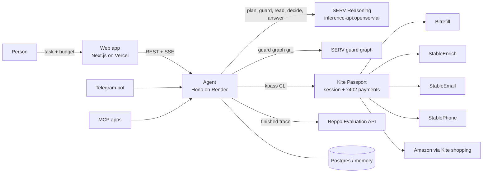
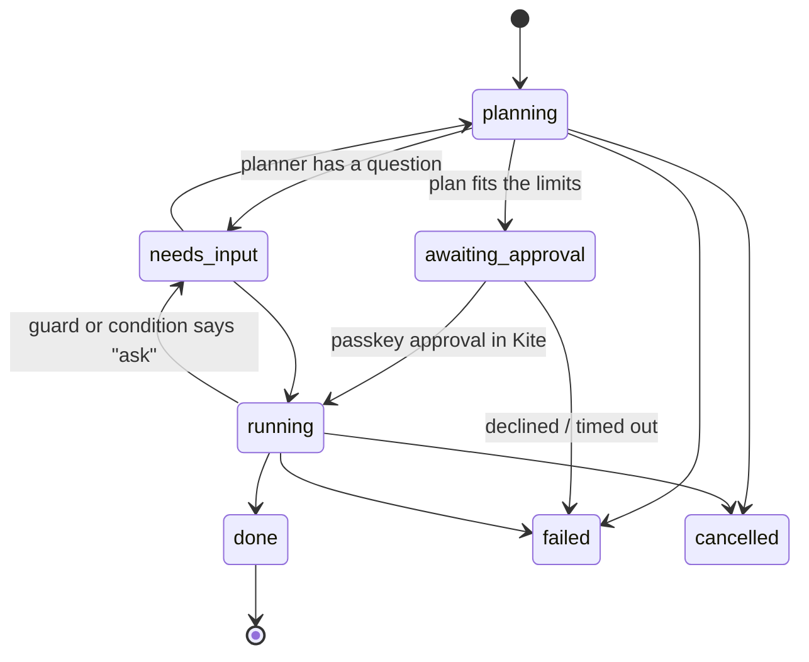
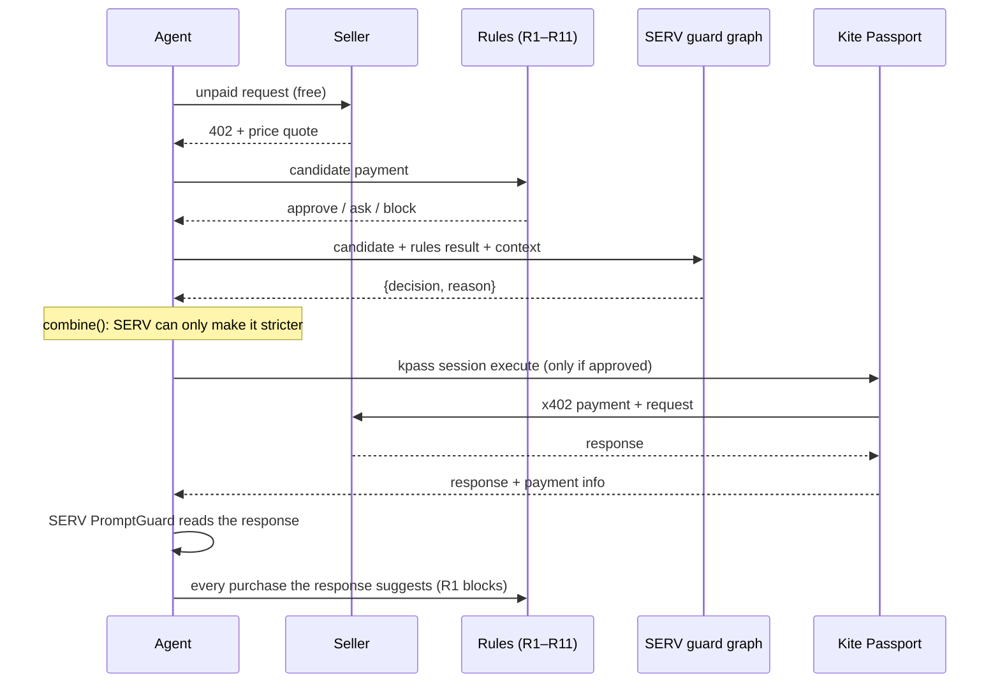
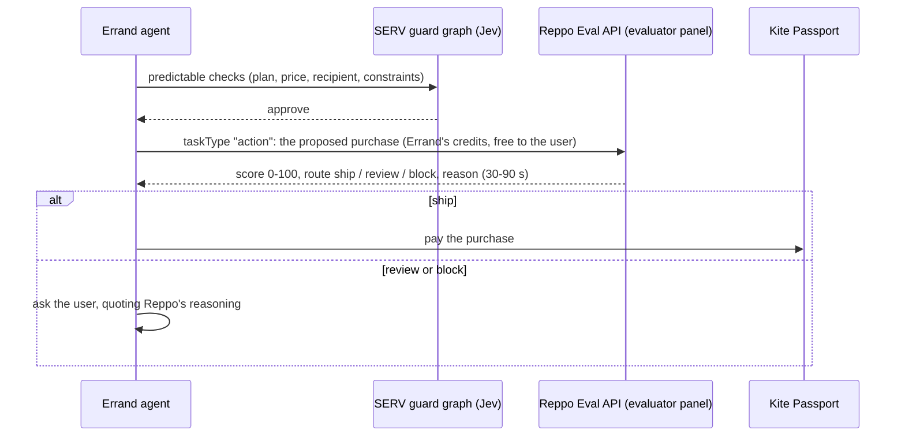
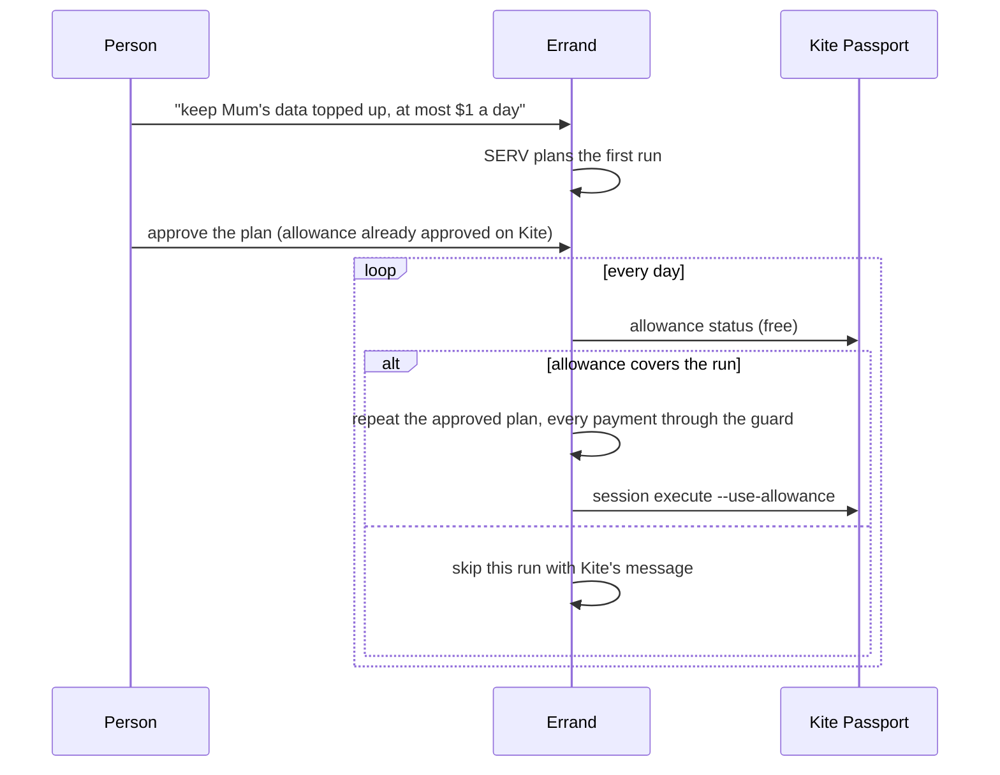

# Architecture

## Errand lifecycle

## One payment

## Packages

| Path | What |
|---|---|
| `packages/core` | Types, seller catalog (allowlist), rules R1–R11, plan validation, phone normalisation, metrics. Pure, unit-tested. |
| `apps/agent` | Hono server, SERV client, kpass wrapper, seller adapters, runner, Reppo worker, demo mode. |
| `apps/web` | Next.js 15 App Router + Tailwind 4: landing, composer, live errand, receipt, results, guard test page. |

## How SERV is used (the write-up's core paragraph)

| Call | Model | SERV feature | Output |
|---|---|---|---|
| Plan | `gpt-5.4-mini-serv-kronos` | Kronos audits the reasoning prompt; strict JSON schema | Plan: steps, prices, conditions, recipients, questions |
| Guard (every payment) | `gr_…` guard graph on `/v1/responses` | Graph: script steps (free), Jev decision steps, agent step for the reason | `{decision, reason}` |
| Guard fallback | `gpt-5.4-mini` + `serv_shadow_agent` | Shadow Agent validation, max 2 iterations | `{decision, reason}` |
| Read paid response | `gpt-5.4-mini` + `serv_prompt_guard` | PromptGuard + strict JSON | facts, sources, suggested purchases |
| Research → act | `gpt-5.4-mini` | strict JSON | proceed / skip / ask |
| Answer | `gpt-5.4-mini` | strict JSON | answer, citations, which steps were used |

Every request has a system message, and nothing streams (Shadow Agent and graphs both require that).

## Rules (packages/core/src/guard.ts)

| Rule | Blocks |
|---|---|
| R1 origin | any purchase suggested inside a paid response |
| R2 allowlist | any URL + method not in the catalog |
| R3 in plan | a step id not in the approved plan, or an endpoint that step may not pay |
| R4 catalog price | a seller asking more than its listed price |
| R5 per payment | above the session's per-payment cap |
| R6 budget | past the errand's total budget |
| R7 step budget | past the step's planned maximum |
| R8 duplicate | the same request paid twice (status checks excepted) |
| R9 call cap | more than 20 paid calls |
| R10 recipient | money or messages to anyone not in the plan (E.164 / lower-cased email) |
| R11 invoice | ask if the invoice is >3% above plan, block if >15% |

## Added on 4 Nov (partner feedback)

| Rule | Effect |
|---|---|
| R12 ask above | Ask before any single payment above the user's own threshold |
| R13 checkout | An Amazon checkout must charge exactly the approved cap + Kite's $1 fee, and the cap can't exceed the plan's |
| R3 (extended) | A Reppo payment is only allowed from a step that asked for a second opinion |

Public guard service rules (`packages/core/src/external.ts`, behind `POST /check` and Errand Guard on Kite): E1 https only · E2 price present · E3 per-payment cap · E4 budget left · E5 steered by earlier seller text · E6 recipient (approved list, or mentioned in the task; otherwise ask).

## Added on 5 Nov: who pays, and how often

| Funding | Approved by | Used for |
|---|---|---|
| Separate Kite session (`kpass session create --separate`) | The payer's passkey, per errand | One-off errands, Amazon checkouts |
| Kite allowance (`kpass session execute --use-allowance`) | The payer's passkey, once on Kite; the plan once in Errand | Standing errands (repeat daily or weekly). Never Amazon. |

The payer is the person's own connected Passport (`/connect`, one login folder each under `PASSPORTS_DIR`) or, if they didn't connect one, Errand's own Passport (access code required in live mode).

Amazon orders: `shop:search` (free) → pick the best-rated item within the cap → optional Reppo second opinion → `shop:cart` → `shop:shipping view` → **order summary the person must confirm** → guard (R13) → `shop:checkout --confirmed --max-total <cap>`.
